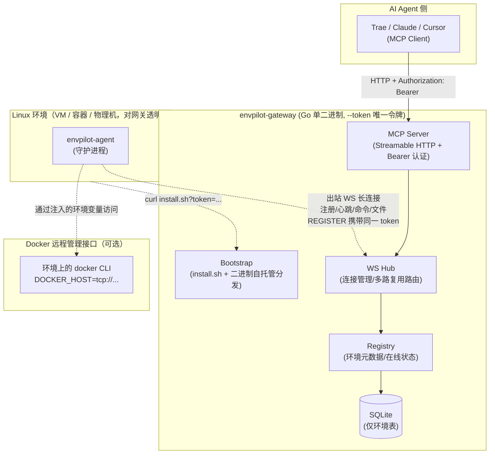
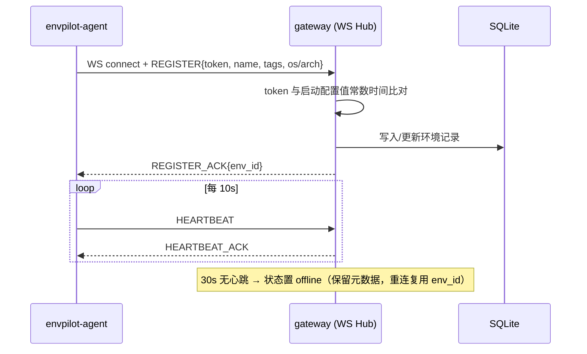
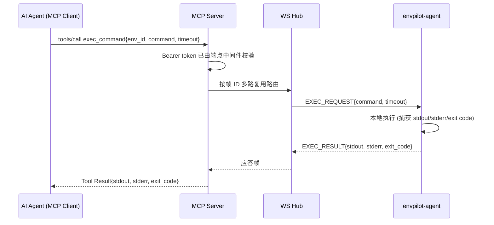
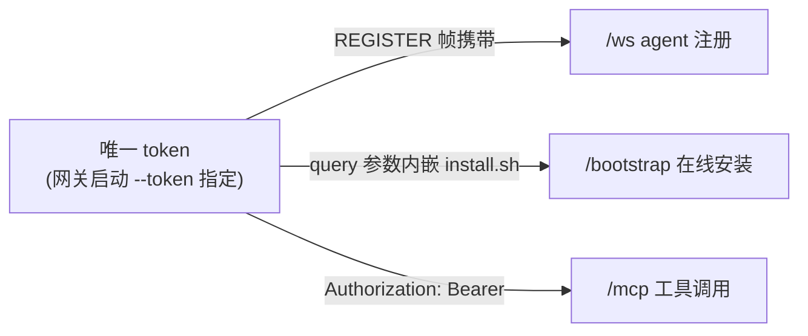

# EnvPilot 轻量级环境网关 — 架构设计方案

> 版本: v0.2（简化版） | 日期: 2026-10-13
> 定位: 一个 Go 单二进制网关，聚合 Linux 环境（虚拟机/容器/物理机，网关不区分），通过 MCP 协议向 AI Agent 提供环境发现与操作能力。
> v0.2 变更: 移除 REST 管理面、Docker provider、审计日志与 token 签发体系，全程单一 token 认证，不做环境隔离。

---

## Slide 1 — 设计目标

| 目标 | 说明 |
|------|------|
| 轻量 | 网关与环境侧 agent 均为 Go 单二进制，交叉编译后 `scp` 即部署，网关内存占用 < 50MB |
| 极简认证 | 全程**单一 token**（启动网关时 `--token` 指定）：环境注册、在线安装脚本、MCP 调用共用 |
| NAT 友好 | 环境侧只发起**出站** WebSocket 连接，无需在环境上暴露任何入站端口 |
| Agent 友好 | 以 MCP (Streamable HTTP) 暴露工具，Claude / Trae / Cursor 等 Agent 可直接接入 |
| 环境即 Linux | 只注册 Linux 环境（VM/容器均可）；Docker 远程管理接口通过环境变量（如 `DOCKER_HOST`）注入环境后由 Agent 在环境上自行使用 |

**非目标（不做）**: 多租户、环境隔离（scope）、Web 管理控制台、REST 管理面、token 签发/撤销、审计日志、Docker 生命周期托管、环境侧 Docker 镜像、集群高可用、端口转发。

---

## Slide 2 — 总体架构



---

## Slide 3 — 核心组件职责

### 3.1 envpilot-gateway（网关）

| 模块 | 职责 |
|------|------|
| MCP Server | 以 MCP 工具形式暴露环境能力，端点 `Authorization: Bearer <token>` 认证 |
| WS Hub | 维护所有环境 agent 的反向长连接；将 MCP 工具调用按 `env_id` 路由到对应连接；帧多路复用 |
| Bootstrap | 自托管 install.sh 与各平台 agent 二进制，环境侧一条 `curl \| bash` 完成安装注册 |
| Registry | 环境元数据注册表，心跳超时判定离线 |
| SQLite 持久化 | **仅一张 environments 表**（`modernc.org/sqlite` 纯 Go，无 CGO） |

### 3.2 envpilot-agent（环境侧，同一代码库另一 main）

```bash
# 方式一（推荐）：在线一键注册
# 网关自托管安装脚本与各平台 agent 二进制（--agent-bindir 目录）
curl -sSL "http://gw:8080/bootstrap/install.sh?token=<token>&name=nic-01&tags=role=nettest&env=DOCKER_HOST=tcp://10.0.0.5:2375" | bash
# root + systemd 环境自动安装为系统服务；容器/无 systemd 环境自动 nohup 后台运行
# env 参数注入任意环境变量（K1=V1,K2=V2），如 docker 远程管理接口 DOCKER_HOST
# 调试前台运行：FOREGROUND=1 curl ... | bash

# 方式二：手动安装（已有 agent 二进制时）
envpilot-agent --gateway ws://gw:8080/ws --token <token> \
    --name nic-test-01 --tags role=nettest
```

- **register**: 出站 WS 注册（携带同一 token）→ 网关常数时间比对配置值 → 返回 env_id
- **守护模式**: 断线指数退避重连；心跳间隔 10s，30s 无心跳网关判定离线
- **执行器**: 非交互命令（`exec.Command` + timeout）；文件读写/list/stat（20MB 上限，base64）

---

## Slide 4 — 关键数据流

### 4.1 注册与心跳



### 4.2 命令执行（Agent → MCP → 环境）



文件操作（read/write/list/stat/download）与命令执行同构，仅帧类型不同。

---

## Slide 5 — WS 帧协议（数据面）

单条 WS 连接上多路复用，帧结构（JSON）：

```jsonc
{
  "id": 1024,                // 请求/应答关联键（多路复用）
  "type": "EXEC_REQUEST",    // 见下表
  "payload": { ... }
}
```

| 类别 | 帧类型 |
|------|--------|
| 连接管理 | REGISTER, REGISTER_ACK, HEARTBEAT, HEARTBEAT_ACK, ERR |
| 命令执行 | EXEC_REQUEST, EXEC_RESULT |
| 文件 | FILE_READ, FILE_WRITE, LIST_DIR, FILE_STAT |

---

## Slide 6 — MCP 工具清单（共 8 个）

| 工具 | 参数 | 说明 |
|------|------|------|
| `list_environments` | `type?`, `online?` | 环境发现，返回元数据列表 |
| `get_environment` | `env_id` | 详情：OS、架构、标签、能力、在线状态 |
| `exec_command` | `env_id, command, timeout_seconds?` | 同步执行，返回 stdout/stderr/exit_code |
| `read_file` | `env_id, path` | 读文本文件（≤2MB） |
| `write_file` | `env_id, path, content, append?` | 写文件（≤20MB，自动建父目录） |
| `list_dir` | `env_id, path` | 目录浏览 |
| `file_stat` | `env_id, path` | 文件元信息 |
| `download_file` | `env_id, path` | 取回文件（≤20MB，base64，适合日志/pcap） |

MCP 传输：**Streamable HTTP**（`http://gw:8080/mcp`，`Authorization: Bearer <token>`，需支持自定义 HTTP 头的 MCP 客户端）。

---

## Slide 7 — 安全模型（极简单 token）



- **认证**: 全部三处入口（`/ws` 注册、`/bootstrap` 安装、`/mcp` 调用）校验同一个 token；比对使用常数时间比较
- **无隔离**: 持有 token 即可访问全部环境与全部工具；token 更换需重启网关（环境侧 agent 与 MCP 客户端同步更新）
- **传输**: 生产建议置于 Caddy/Nginx 反代之后终结 TLS（`wss://`）
- **边界**: 定位为**受信内网工具**，命令不做内容过滤；环境侧 agent 建议非 root 运行

---

## Slide 8 — 技术选型与开源参考

| 领域 | 选型 | 参考仓库 |
|------|------|----------|
| 语言/构建 | Go，单 repo 双 main | https://github.com/golang/go |
| MCP Go SDK | `mark3labs/mcp-go` | https://github.com/mark3labs/mcp-go |
| WebSocket | `coder/websocket`（原 nhooyr/websocket） | https://github.com/coder/websocket |
| 多路复用参考 | `hashicorp/yamux`（帧设计借鉴，自实现轻量 JSON 帧） | https://github.com/hashicorp/yamux |
| 存储 | `modernc.org/sqlite`（纯 Go 无 CGO，交叉编译友好） | https://gitlab.com/cznic/sqlite |
| 架构参考 | ShellHub（反向连接设备网关） | https://github.com/shellhub-io/shellhub |

---

## Slide 9 — 代码结构（单 repo）

```
EnvPilot/
├── cmd/
│   ├── gateway/main.go        # envpilot-gateway 入口（--addr/--token/--db/--agent-bindir）
│   └── agent/main.go          # envpilot-agent 入口（--gateway/--token/--name/--type/--tags）
├── internal/
│   ├── proto/                 # WS 帧定义与编解码
│   ├── gateway/
│   │   ├── auth/              # 单 token Bearer 中间件
│   │   ├── bootstrap/         # 在线安装（install.sh 生成 + 二进制分发）
│   │   ├── mcpserver/         # MCP server (Streamable HTTP, 8 工具)
│   │   ├── hub/               # WS 连接管理/路由/多路复用
│   │   ├── registry/          # 环境注册表 + 心跳状态机
│   │   └── store/             # SQLite（仅 environments 表）
│   └── agent/
│       ├── client/            # WS 客户端/重连/心跳
│       ├── exec/              # 命令执行
│       └── files/             # 文件操作
├── bin/                       # 编译产物（网关 + 各平台 agent，供 bootstrap 分发）
└── docs/
```

---

## Slide 10 — 实施里程碑

| 阶段 | 交付物 | 状态 |
|------|--------|------|
| M1 MVP | 网关+agent 骨架、注册/心跳/重连、MCP (HTTP)、`list_environments` / `exec_command` | ✅ 完成 |
| M1.5 持久化 | SQLite 环境持久化、重启 env_id 复用、bootstrap 在线一键注册 | ✅ 完成 |
| M2 文件 | read/write/list/stat/download 工具 | ✅ 完成 |
| 端口转发 | — | ❌ 移除（不实现） |
| Docker 生命周期托管（M4） | — | ❌ 移除（v0.2 简化；docker 仅作为环境上的远程管理接口，通过 `env=DOCKER_HOST=...` 注入） |
| v0.2 简化 | 删 REST 管理面/token 签发/审计/scope；单 token 全链路认证 | ✅ 完成（单 token 冒烟通过：注册、MCP 8 工具、错误 token 401/拒绝、install.sh 生成） |
